# TaskForge — Task Management Dashboard

TaskForge is a task management dashboard built with **plain HTML and JavaScript**, styled with **Tailwind CSS v4** compiled by the **Tailwind CLI**. It uses no JavaScript frameworks or libraries. Every part of the interface is created and updated with the DOM API: the task list, statistics, filters, modals, pagination and notifications.

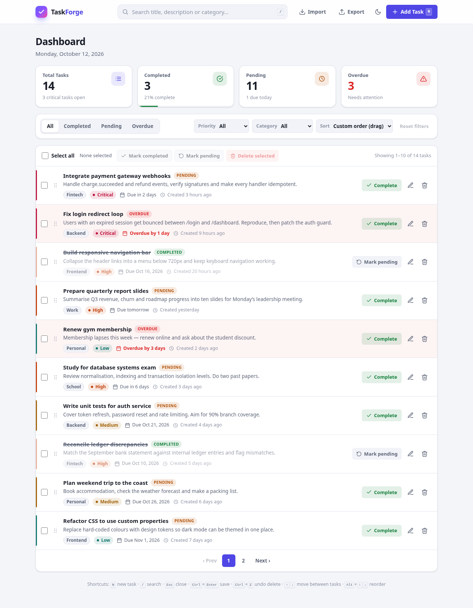

---

## Table of contents

1. [Running the project](#running-the-project)
2. [Features](#features)
3. [Project structure](#project-structure)
4. [Styling with Tailwind CSS](#styling-with-tailwind-css)
5. [Task management logic](#task-management-logic)
6. [Event delegation](#event-delegation)
7. [localStorage implementation](#localstorage-implementation)
8. [Major DOM methods used](#major-dom-methods-used)
9. [Keyboard shortcuts](#keyboard-shortcuts)
10. [Bonus features](#bonus-features)
11. [Screenshots](#screenshots)

---

## Running the project

The compiled stylesheet (`style.css`) is included in the repository, so you only need to:

1. Clone or download the repository.
2. Open `index.html` in any modern browser (Chrome, Edge, Firefox, Safari).

To change the styles, install the Tailwind CLI and rebuild:

```bash
npm install        # installs tailwindcss and @tailwindcss/cli (dev dependencies)
npm run dev        # rebuilds style.css whenever index.html, app.js or src/input.css changes
npm run build      # one-off minified build of style.css
```

The first time it opens, TaskForge fills the dashboard with **14 sample tasks**. They cover every category, every priority, past and future due dates, and both completed and pending tasks, so the overdue logic, filters and pagination can be seen right away.

> To start over with the sample data, run `localStorage.clear()` in the browser console and reload the page.

---

## Features

| Area | What it does |
| --- | --- |
| **Header / navigation** | Logo, search bar, Import, Export, dark-mode toggle and **Add Task** button. |
| **Statistics** | Total, Completed, Pending and Overdue counts. They update after every change and also act as status filters when clicked. |
| **Add / edit form** | Title, description, category, priority and due date. Submitting does not reload the page. Validation errors appear under each field and clear as soon as the field is fixed. |
| **Validation rules** | Title: required, at least 3 characters. Description: required, at least 10 characters. Category, priority and due date: required. |
| **Task card** | Shows the title, description, category, priority, due date, creation date and status, plus a checkbox and Complete, Edit and Delete buttons. |
| **Complete / pending** | Switches a task between completed and pending. Completed tasks are faded and their titles are struck through. |
| **Overdue detection** | A task is overdue when its due date has passed and it is not completed. Overdue tasks get a red background, an *Overdue* badge and an "Overdue by N days" label. |
| **Delete** | A confirmation modal opens, and the user can cancel or confirm. |
| **Details modal** | Clicking a task opens its full details, with Close, Edit, Delete and Mark completed/pending buttons. |
| **Search** | Searches title, description and category. Matching text is highlighted with `<mark>`. |
| **Filters** | Status (All / Completed / Pending / Overdue), priority (All / Low / Medium / High / Critical) and category (All / Work / Personal / School / Backend / Frontend / Fintech / Other). Search and all filters can be combined. |
| **Sorting** | Newest, Oldest, A → Z, Z → A, Highest Priority, Lowest Priority, Closest Due Date, Furthest Due Date, plus *Custom order* for drag and drop. |
| **Multi-select** | A checkbox on every task, Select All (with a partial state when only some tasks are checked), a selected-task counter, and bulk **Mark completed**, **Mark pending** and **Delete**. |
| **Empty states** | "No tasks yet" when there are no tasks (with buttons to create one or load samples), and "No tasks found" when the search or filters hide every task. |
| **Unsaved changes** | If the form has been changed but not saved, closing it (✕, Cancel, Esc or a backdrop click) asks whether to discard the changes. The browser also warns before the page is closed. |
| **Dark mode** | A theme toggle whose choice is saved in `localStorage`. On the first visit the OS colour-scheme setting is used. It is implemented with Tailwind's `dark:` variant tied to `data-theme`. |
| **Persistence** | Every change is saved to `localStorage` and loaded again on startup. |

---

## Project structure

```
├── index.html        Page markup with Tailwind utility classes, the task <template>, three modals, SVG icon sprite
├── src/
│   └── input.css     Tailwind source: theme tokens, dark-mode variant, animations, a few component classes
├── style.css         GENERATED by the Tailwind CLI from src/input.css. Do not edit by hand.
├── app.js            All application logic (about 1,800 lines in 15 commented sections)
├── package.json      Tailwind CLI dev dependencies and the build / dev scripts
├── README.md
└── screenshots/      Screenshots of the finished application
```

`app.js` is split into numbered sections:

1. Constants
2. State and DOM references
3. Utilities
4. Persistence
5. Sample data
6. Queries (filter, search and sort)
7. Rendering
8. Task actions
9. Selection and bulk actions
10. Modals
11. Toasts
12. Theme
13. Import and export
14. Event listeners
15. Initialisation

---

## Styling with Tailwind CSS

All styling uses **Tailwind CSS v4**, compiled with the **Tailwind CLI** (`@tailwindcss/cli`). There is no hand-written stylesheet and no CDN script.

**What `src/input.css` contains**

- `@import "tailwindcss" source(none)` together with `@source "../index.html"` and `@source "../app.js"`. These limit the CLI to scanning only the two files that contain class names.
- An `@theme` block that defines the colour tokens (`canvas`, `surface`, `line`, `ink`, `muted`, `brand`, `success`, `danger`, `warning`, and `p-low` to `p-critical` for priorities) and the custom animations. Each token becomes a utility, for example `bg-surface`, `text-muted`, `border-line` or `bg-brand/10`.
- `@custom-variant dark (&:where([data-theme="dark"], [data-theme="dark"] *))`. With this, the `dark:` variant follows the **theme toggle** (`<html data-theme="dark">`) instead of the operating-system setting.
- A dark-mode block that changes the token values, so every utility that uses a token switches theme automatically.
- A small `@layer components` with `@apply` for the buttons (`btn`, `btn-primary`…) and `badge`. These are repeated many times, including in markup created by JavaScript.

**Styling state classes that JavaScript toggles**

The assignment asks JavaScript to add, remove and toggle classes such as `task--completed`, `task--overdue` and `priority--high`. Those classes are kept as **hooks** and styled with Tailwind's arbitrary variants:

```html
<li class="task-card group …
           [&.task--overdue]:bg-danger/5
           [&.priority--critical]:before:bg-p-critical
           [&.is-selected]:bg-brand/10!">
  <h3 class="task-title … group-[.task--completed]:line-through group-[.task--completed]:text-muted"></h3>
```

So `card.classList.toggle('task--completed', task.completed)` in `app.js` still drives the appearance, with all the styling written as Tailwind utilities. Built-in state variants are used where possible: `aria-pressed:` for the status filter buttons, `aria-[current=page]:` for the current page button, `aria-invalid:` for fields with errors, and `peer-focus:` to hide the search shortcut hint.

**Markup created in JavaScript**

The Tailwind CLI only generates classes it can find as **complete strings** in the scanned files. `app.js` therefore keeps its class names in lookup objects (`PRIORITY_BADGE_CLASSES`, `STATUS_BADGE_CLASSES`, `TOAST_TYPE_CLASSES`, `UI_CLASSES`) and never builds them by joining strings (no `` `bg-${color}` ``).

Class names such as `task-card`, `task-title` and `task-checkbox` have no styles of their own. They exist only so JavaScript can find elements with `querySelector()` and `closest()`.

---

## Task management logic

### A single source of truth

All data lives in one `state` object. The DOM is always **rendered from state** and is never used as the place where data is stored.

```js
const state = {
  tasks: [],               // array order = the custom (drag & drop) order
  filters: { search: '', status: 'all', priority: 'all', category: 'all' },
  sort: 'manual',
  page: 1,
  selected: new Set(),     // ids of checked tasks
  editingId: null,         // the task loaded into the form (null = new task)
  formSnapshot: '',        // form values when it opened, used to detect unsaved changes
  undoStack: [],           // recently deleted tasks with their original positions
  ...
};
```

Each task is a plain object:

```js
{
  id: "6f1c…",             // crypto.randomUUID()
  title: "Fix login redirect loop",
  description: "Users with an expired session…",
  category: "backend",     // work | personal | school | backend | frontend | fintech | other
  priority: "critical",    // low | medium | high | critical
  dueDate: "2026-10-11",   // YYYY-MM-DD, the same format as <input type="date">
  completed: false,
  createdAt: "2026-10-12T07:14:00.000Z",
  updatedAt: "2026-10-12T07:14:00.000Z"
}
```

### How every change flows

Every action follows the same steps:

```
user event → update state.tasks → saveTasks() → render()
                                                  ├─ renderStats()        statistics
                                                  ├─ renderTasks()        list, empty state, pagination
                                                  └─ updateSelectionUI()  checkbox count, bulk buttons
```

The statistics are recalculated on every render, so they can never fall out of step with the data.

### Status and overdue

Status is **calculated, never stored**:

```js
function isOverdue(task) {
  return !task.completed && daysUntilDue(task) < 0;
}
function getStatus(task) {
  if (task.completed) return 'completed';
  return isOverdue(task) ? 'overdue' : 'pending';
}
```

Because of this, a task becomes overdue on its own once its due date passes. A timer and a `visibilitychange` listener re-render the page when the date changes, for example if the tab stays open past midnight.

Due dates are read as **local** dates (`new Date(y, m - 1, d)`). `new Date("2026-10-12")` would be read as UTC midnight, which can shift the date by a day in some time zones.

### Search, filter, sort, paginate

`getVisibleTasks()` runs one pipeline, so all the controls work together:

1. **Filter.** A task must pass every check: status, priority, category and the search term. The search looks in the title, description and category label.
2. **Sort.** `SORTERS` is a lookup table of compare functions. When two tasks tie, a second key decides; for example, Highest Priority then sorts by due date. *Custom order* keeps the array order.
3. **Paginate.** `renderTasks()` takes the slice of 10 tasks for the current page. If the current page no longer exists after a change, it moves to the last valid page.

### Classes toggled for each task

`applyTaskClasses()` uses `classList.toggle(name, condition)` to set the state classes on each card. The CSS uses those classes for the appearance.

| Class | Applied when | Visual effect |
| --- | --- | --- |
| `task--completed` | `task.completed` | Faded text, struck-through title, green stripe |
| `task--pending` | `!task.completed` | Normal appearance |
| `task--overdue` | `isOverdue(task)` | Red background, red due-date text |
| `priority--low` / `--medium` / `--high` / `--critical` | Matches `task.priority` | Coloured stripe on the left edge |
| `is-selected` | The task's checkbox is checked | Highlighted background |

### Validation

`validateTask()` is a pure function that returns an object such as `{ title: 'Title must be at least 3 characters.' }`. `setFieldError()` then:

- puts each message in the field's error element, which is found with `field.nextElementSibling`;
- adds the `has-error` class to `field.parentElement`;
- sets `aria-invalid` so screen readers announce the error.

After the first failed submit, each field is checked again as the user types, so its error disappears as soon as it is fixed.

### Unsaved-change detection

When the form opens, `serializeForm()` stores the form values as a JSON string built from `FormData`. Any later close attempt compares the current values with that snapshot. If they differ, a confirmation asks whether to discard the changes.

---

## Event delegation

Task cards are created and destroyed all the time. Instead of adding listeners to each button, **one listener on the parent `<ul>`** handles every card, including cards added later. The clicked card is found with `closest()`, and the task id is read from `data-*` attributes:

```js
els.taskList.addEventListener('click', (event) => {
  const card = event.target.closest('.task-card');            // DOM traversal up to the card
  if (!card || !event.currentTarget.contains(card)) return;   // currentTarget = the <ul>
  if (event.target.closest('.task-select, .drag-handle')) return;

  const id = card.dataset.id;                                 // data-id="…" links the DOM to the task
  const actionElement = event.target.closest('[data-action]');
  const action = actionElement ? actionElement.dataset.action : 'open';

  switch (action) {
    case 'toggle': toggleTask(id); break;
    case 'edit':   openTaskForm(id); break;
    case 'delete': requestDelete([id]); break;
    default:       openDetails(id);       // clicking the card body opens the details modal
  }
});
```

Delegated listeners in the app:

| Container | Events | Handles |
| --- | --- | --- |
| `#task-list` | `click` | Complete, Edit and Delete buttons, and opening the details modal |
| `#task-list` | `change` | Task checkboxes |
| `#task-list` | `keydown` | ↑ ↓ Home End (move between cards), Enter, Space, Delete, Alt + ↑↓ (reorder) |
| `#task-list` | `mousedown`, `dragstart`, `dragover`, `drop`, `dragend` | Drag-and-drop reordering |
| `#status-filters` | `click` | The four status buttons |
| `.stats` | `click` | Stat cards used as filters |
| `#bulk-actions` | `click` | Bulk complete, pending and delete (`data-bulk="…"`) |
| `#pagination` | `click` | Page buttons (`data-page="…"`) |
| `#list-message` | `click` | Empty-state and no-results buttons (`data-message-action="…"`) |
| `#details-modal` | `click` | Edit, Delete and Toggle (`data-details-action="…"`). The task id is read from `event.currentTarget.dataset.id`. |
| `.modal-overlay` | `click` | Any `[data-close]` button, and clicks on the backdrop (`event.target === event.currentTarget`) |
| `#task-form` | `input`, `change` | Live re-validation of any field |

### `data-*` attributes used

| Attribute | Where | Purpose |
| --- | --- | --- |
| `data-id` | Each task card and the details modal | Links an element to its task object |
| `data-status`, `data-priority`, `data-category` | Each task card | Describe the task's state on the element itself |
| `data-action` | Card buttons and the card body | Tells the delegated handler what to do |
| `data-status` | Filter buttons and stat cards | The status filter each one applies |
| `data-bulk` | Bulk action buttons | Which bulk action to run |
| `data-page` | Pagination buttons | The page to go to |
| `data-details-action`, `data-message-action` | Modal and empty-state buttons | Which action to run |
| `data-close` | ✕, Cancel and Close buttons | Closes the surrounding modal |
| `data-theme` | `<html>` | Switches every CSS colour token between light and dark |

---

## localStorage implementation

Two keys are used:

| Key | Value |
| --- | --- |
| `taskforge:tasks` | `JSON.stringify(state.tasks)`, the full task array in custom order |
| `taskforge:theme` | `"light"` or `"dark"` |

**Saving.** `saveTasks()` runs after every change: create, edit, toggle, delete, undo, bulk actions, reorder and import. It is wrapped in `try/catch`, so a full or disabled storage shows an error toast instead of crashing the app.

```js
function saveTasks() {
  try {
    localStorage.setItem(STORAGE_KEYS.tasks, JSON.stringify(state.tasks));
  } catch (error) {
    showToast('Could not save your tasks — browser storage may be full or disabled.', { type: 'error' });
  }
}
```

**Loading.** `loadTasks()` runs once on startup:

- If **nothing has ever been saved** (`getItem` returns `null`), this is the first visit, so the sample tasks are created and saved.
- If the user later deletes every task, the key holds `"[]"`, so the samples are **not** added again and the empty state is shown instead.
- The parsed data goes through `normalizeTask()`, which fixes or rejects bad records. Corrupted JSON is caught and ignored.

**Theme.** The saved theme is applied on startup. When no theme has been saved, the OS `prefers-color-scheme` setting is used.

**Multiple tabs.** A `storage` event listener re-renders the page when another tab changes the tasks or the theme.

---

## Major DOM methods used

Each method listed in the assignment is used where it fits:

| Method / property | Where it is used in `app.js` |
| --- | --- |
| `getElementById()` | All element references are cached once in the `els` object |
| `querySelector()` | Finding parts of a cloned card (`.task-title`, `.task-checkbox`…), `findCard(id)` |
| `querySelectorAll()` | Syncing the status buttons, bulk buttons and checkboxes; collecting focusable elements for the focus trap |
| `createElement()` | Toasts, the empty-state block, `<mark>` search highlights, the export download link |
| `append()` | Adding several nodes or text strings at once (empty state, toast buttons, highlighted text) |
| `appendChild()` | Adding cards to the fragment, adding the fragment to the list, adding `<mark>` elements |
| `prepend()` | New toasts go to the top of the toast stack |
| `remove()` | Removing toasts, the temporary download link, and toasts over the limit |
| `removeChild()` | Clearing the task list one node at a time before a re-render |
| `replaceWith()` | `toggleTask()` swaps only the changed card instead of re-rendering the whole list |
| `cloneNode(true)` | Every task card is a deep clone of the `<template id="task-template">` contents |
| `insertAdjacentHTML()` | Details modal body, "No tasks found" message, pagination buttons. User text is escaped with `escapeHTML()` first. |
| `textContent` | All user-supplied text (titles, descriptions), statistics, counters, toast messages |
| `innerHTML` | Clearing containers and inserting fixed SVG icon markup (never user input) |
| `classList` | `add`, `remove` and `toggle` for status, priority, selection, active-filter, error and animation classes |
| `setAttribute()` | `aria-*`, `datetime`, `title`, `draggable`, `disabled`, `hidden` and `data-theme` |
| `getAttribute()` | Reading the current theme and the bulk action name |
| `removeAttribute()` | Showing modals and messages (`hidden`), enabling buttons (`disabled`), ending a drag (`draggable`), clearing `aria-invalid` |
| `dataset` | `card.dataset.id`, `.status`, `.priority`, `.category`, `button.dataset.action`, `dataset.page`… |
| `parentElement` | Adding the error class to a form field's wrapper; marking active filter selects |
| `children` | Stat cards when syncing the active filter; limiting the toast stack |
| `firstElementChild` | Getting the `<li>` inside the template; the Home key; clearing the list |
| `lastElementChild` | The End key; removing the oldest toast |
| `nextElementSibling` | Finding a field's error message; ↓ navigation; drag-and-drop position |
| `previousElementSibling` | ↑ navigation; working out where a dragged or moved task was dropped |
| `closest()` | Finding the card from any clicked child, and the button behind an icon click |
| `addEventListener()` | Every event; only a few listeners are needed thanks to delegation |
| `preventDefault()` | Form submit (no page reload), keyboard shortcuts, `dragover` (to allow dropping), the focus trap |
| `event.target` | The element that was actually clicked or typed in |
| `event.currentTarget` | The element the listener is on (the list, the modal or the overlay) |
| `FormData` | Reading the form in `readForm()` and creating the unsaved-change snapshot in `serializeForm()` |
| `createDocumentFragment()` | `renderTasks()` builds all the cards in a fragment and inserts them into the page in one step |
| `localStorage` | Saving tasks and the theme |
| `JSON.stringify()` / `JSON.parse()` | Saving and loading tasks, export and import, form snapshots |

### Security note

User text is placed in the page with `textContent`, or passed through `escapeHTML()` before it goes into an HTML string. A task titled `` is therefore shown as plain text and never runs.

---

## Keyboard shortcuts

| Key | Action |
| --- | --- |
| <kbd>N</kbd> | Open the new task form |
| <kbd>/</kbd> | Focus the search box |
| <kbd>Esc</kbd> | Close the top modal (asks first if the form has unsaved changes); clears the search when it is focused |
| <kbd>Ctrl</kbd> + <kbd>Enter</kbd> | Submit the task form (<kbd>⌘</kbd> + <kbd>Enter</kbd> on macOS) |
| <kbd>Ctrl</kbd> + <kbd>Z</kbd> | Undo the most recent delete |
| <kbd>↑</kbd> / <kbd>↓</kbd>, <kbd>Home</kbd> / <kbd>End</kbd> | Move between task cards |
| <kbd>Enter</kbd> / <kbd>Space</kbd> / <kbd>Delete</kbd> | On a focused card: open details / select / delete |
| <kbd>Alt</kbd> + <kbd>↑</kbd> / <kbd>↓</kbd> | Move the focused task up or down (keyboard alternative to drag and drop) |

Single-key shortcuts are ignored while the user is typing in a field or while a modal is open. Focus stays inside open modals and returns to the element that opened them when they close.

---

## Bonus features

All five bonus features are implemented.

- **Drag-and-drop reordering.** Choose *Custom order* in the sort menu, then drag a task by its ⋮⋮ handle. During the drag, the card is moved with `insertBefore()`. On drop, `commitCardPosition()` reads the card's new `nextElementSibling` and `previousElementSibling` to find its place in `state.tasks`, then saves the order. A cancelled drag puts the cards back where they were.
- **Pagination.** Ten tasks per page, with Prev/Next, page numbers and `…` gaps for long lists. Changing a filter returns to page 1. Adding or editing a task jumps to the page that contains it.
- **Debounced search.** The `debounce()` helper waits until 300 ms after the last keystroke before filtering.
- **Undo delete.** Each delete (single or bulk) records the removed tasks *and their original positions*. Clicking **Undo** in the toast, or pressing <kbd>Ctrl</kbd>+<kbd>Z</kbd>, puts them back exactly where they were. The undo is available for 7 seconds.
- **Import / export.** **Export** downloads `taskforge-tasks-YYYY-MM-DD.json` using a `Blob` and a temporary `<a download>` link. **Import** reads a JSON file in either `[...]` or `{ "tasks": [...] }` form, checks every record with `normalizeTask()`, shows how many tasks are new and how many will be updated, and then merges them into the current list.

Other additions:

- Search matches are highlighted.
- Clicking a stat card filters by that status.
- A progress bar shows the completion percentage.
- Toast notifications confirm each action.
- The page works on phones.
- The page is accessible: ARIA labels, a focus trap in modals, a skip link, and support for reduced-motion settings.
- Open tabs stay in sync.

---

## Screenshots

| | |
| --- | --- |
|  **Dashboard (light)** | 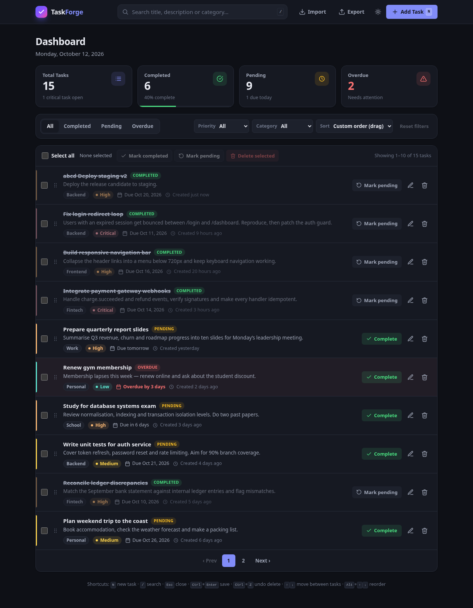 **Dashboard (dark)** |
| 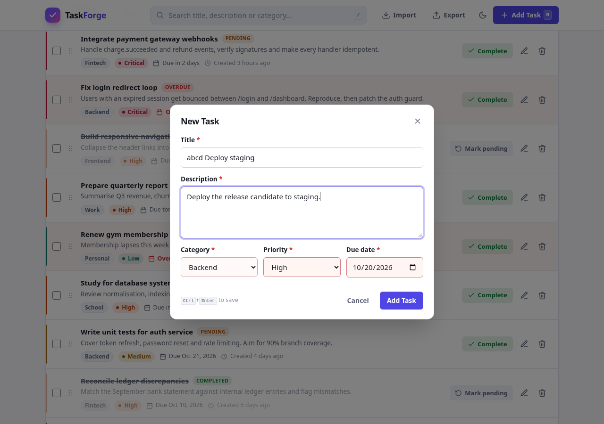 **Add task form** | 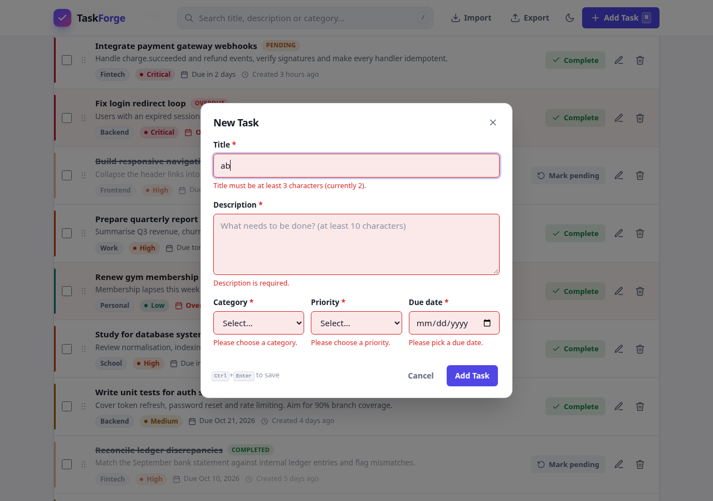 **Validation errors** |
| 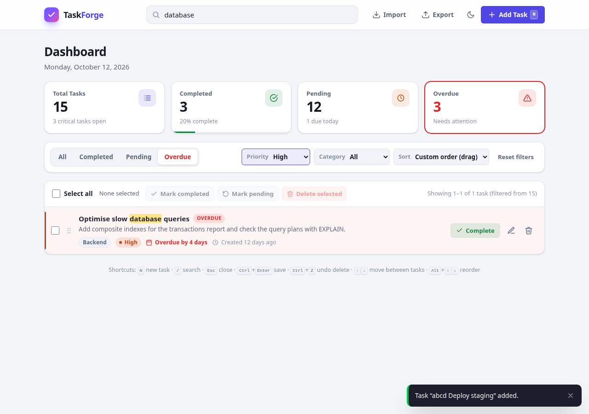 **Search + combined filters** | 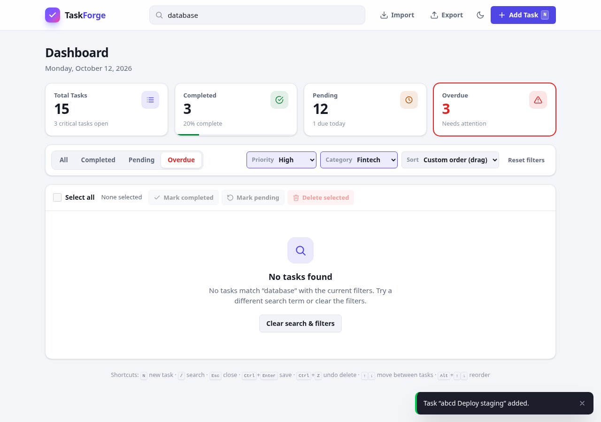 **No tasks found** |
| 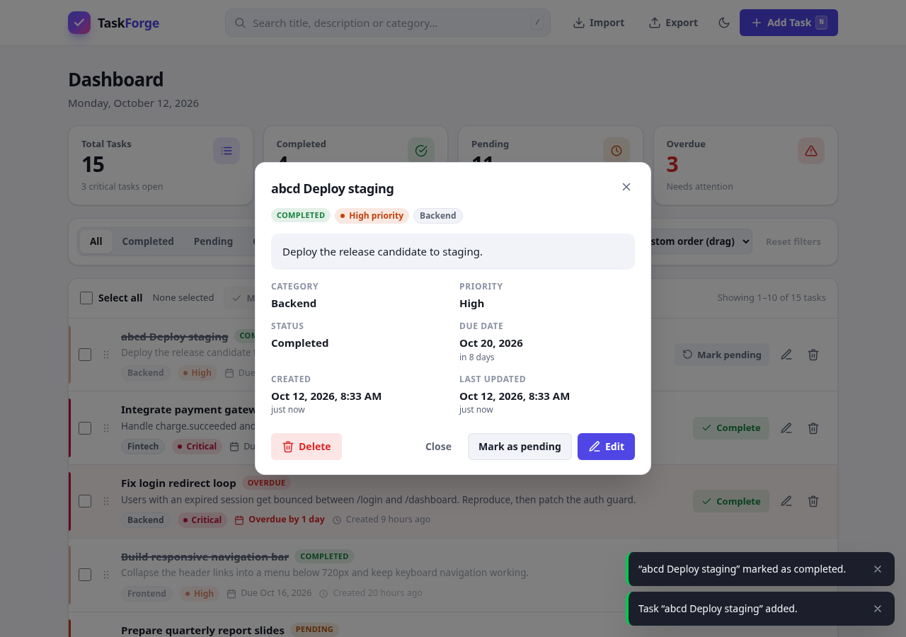 **Task details modal** | 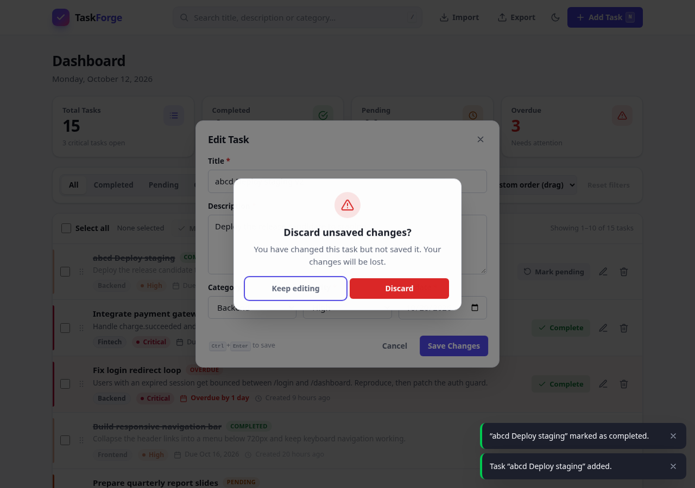 **Unsaved-changes prompt** |
| 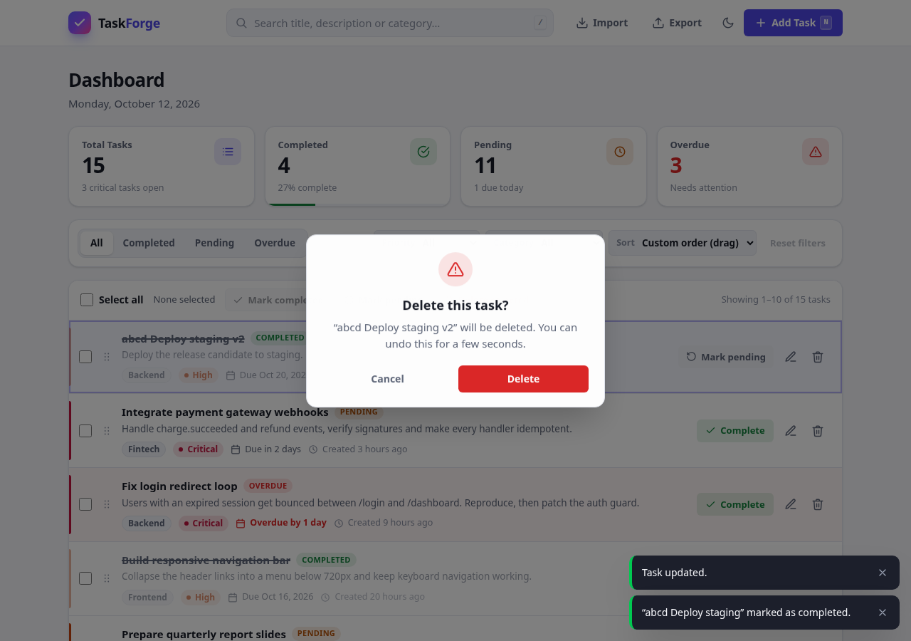 **Delete confirmation** | 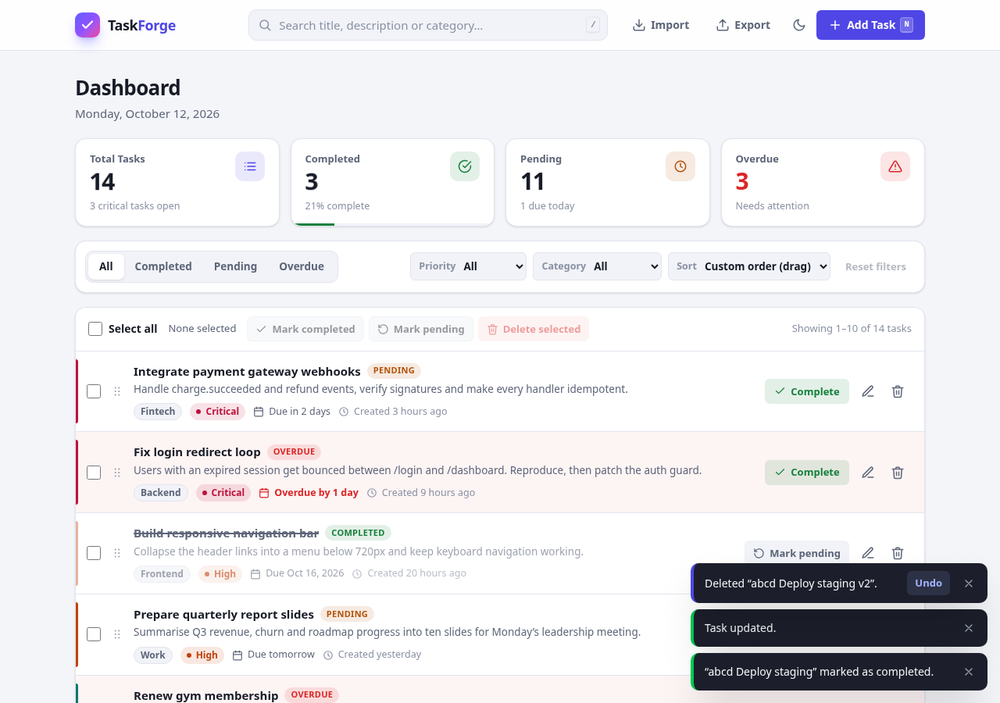 **Undo delete toast** |
| 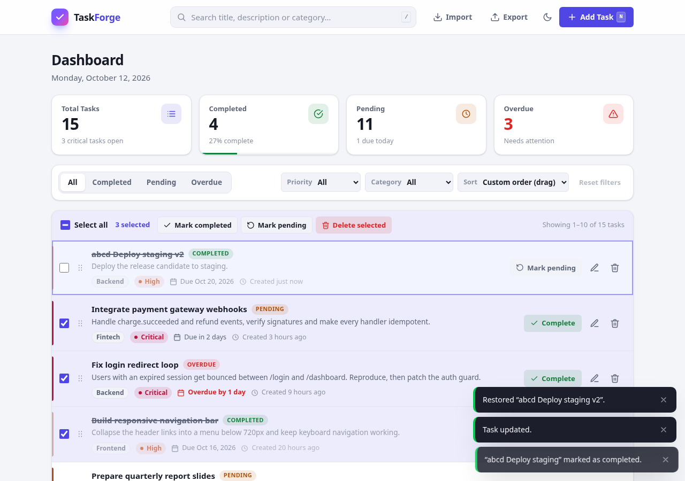 **Bulk selection** | 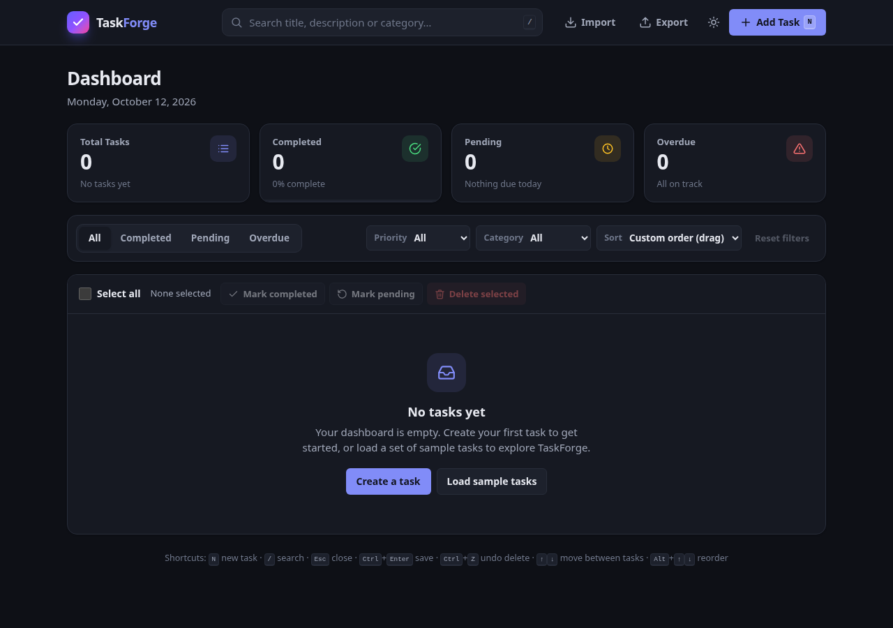 **Empty state** |
| 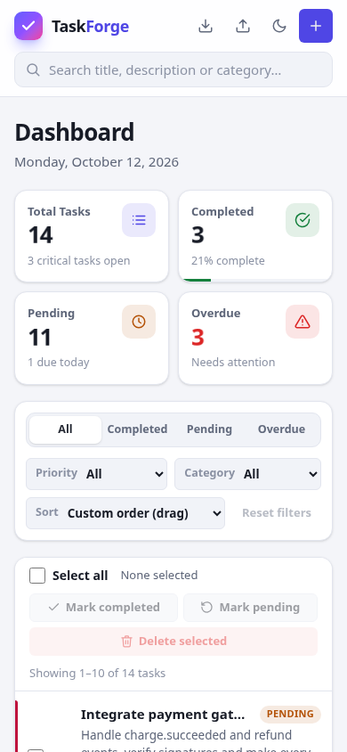 **Mobile layout** | |
